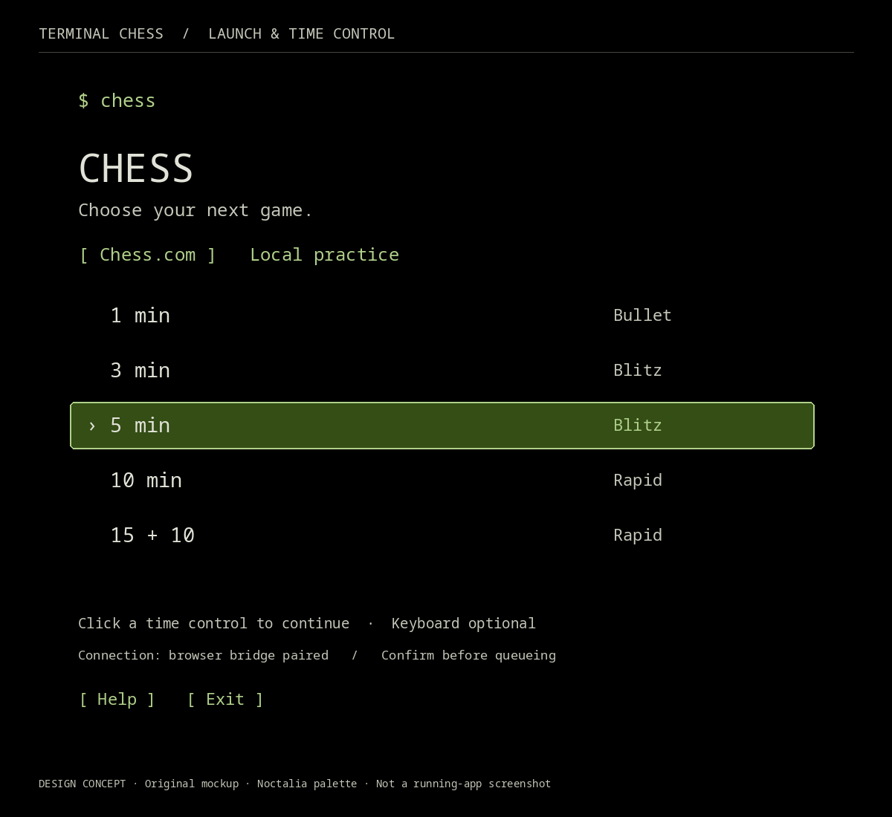
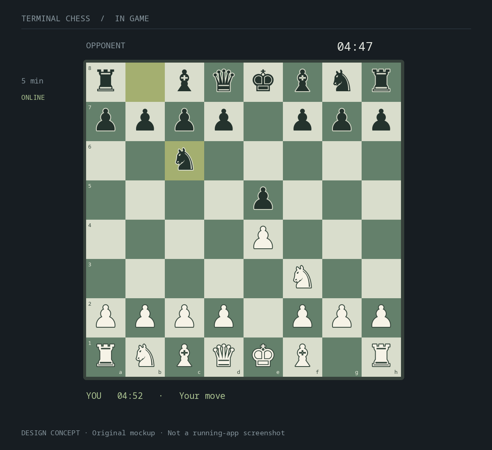
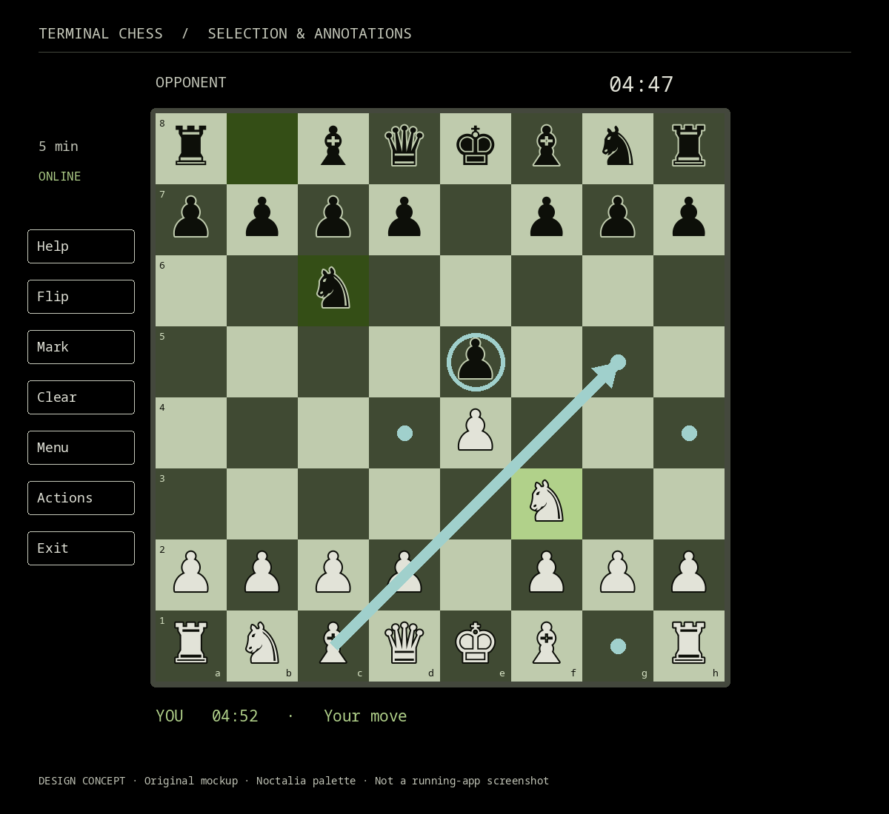

# Terminal Chess — design and implementation plan

**Approved design reference · October 10, 2026 · Implementation resumed**

The working first release is documented in [README](README.md) and [runtime verification](docs/RUN.md). This plan retains the original concept images and proposals; current implementation uses a graphical board inside Ghostty with minimal terminal clocks/status. The supplied reference and subsequent scoped cleanup supersede the earlier ASCII and toolbar proposals. Authenticated online verification remains pending.

This plan describes a proposed product, not an implemented client. The images below are original design concepts, not screenshots of running software. They illustrate visual hierarchy and interaction states; exact terminal dimensions, rendering, and compatibility remain to be prototyped.

## 1. The experience

Type `chess`, select a time control, create a game, and play from a focused terminal board. The entire interface must be operable with the mouse: mode and time selection, connection/setup navigation, confirmations, game actions, piece moves, annotations, promotion, help, and exit. Keyboard shortcuts are optional conveniences; coordinate typing is never required. Click a piece and its destination as on a browser chessboard. Selection, destination, and last-move highlights make actions clear. Draw your own arrows and mark squares. During play, keep the board, clocks, and essential status visible, with the launch menu hidden.

### Launch and time-control menu



The concept shows five minutes alongside 1, 3, 10, and 15+10. These additional presets are proposed defaults, subject to the connected website's actual available controls. The illustrated connection message is hypothetical, not evidence of a paired browser.

### Focused board



The illustrated position follows `1. e4 e5 2. Nf3 Nc6`. Nathan confirms this overall visual experience is broadly right. These revised concepts use the verified Noctalia wallpaper palette, with contrasting piece silhouettes, inset coordinates, small player clocks, and clickable side controls. Exact geometry and renderer remain proposals. Both piece colors use strong silhouettes. Clock values and player labels are placeholders. The board scales within the terminal rather than requiring a particular font configuration.

### Selection and user annotations



The knight on f3 is selected; dots represent legal empty destinations. The teal c1→g5 arrow and e5 circle are user-created annotations, independent of destination highlights. Occupied legal destinations should receive a ring. Annotations do not represent engine advice and should never be generated by an engine during live play.

## 2. Confirmed decisions and proposed defaults

| Topic | Confirmed by Nathan | Proposed for review |
| --- | --- | --- |
| Launch | Type `chess` in a terminal | Mouse controls for the entire interface; optional keyboard shortcuts |
| Game selection | Include five-minute games and other choices | 1, 3, 5, 10, 15+10; display available presets dynamically when feasible |
| Online intent | Chess.com connected play; background bridge acceptable | Authenticated browser session plus a local companion bridge |
| Board | A polished terminal-drawn board is acceptable | Original board with Noctalia-derived colors and restrained chrome |
| Moves | Click piece, then destination; no required coordinate typing | Click selected piece again to deselect; click another friendly piece to switch |
| Markup | Square highlights and annotation arrows | Right-drag for arrows, right-click for circles; fallback annotation mode |
| Theme | Work with Nathan’s Noctalia colors | Read-only palette discovery, semantic mapping, refresh and contrast-safe fallback |
| Planning | Comprehensive Markdown plan with pictures | This draft and three original concept images |
| Privacy | All projects should be private repositories | Keep this repo private; keep credentials and session data out of Git |
| Current scope | Implementation paused for discussion | No app code or extension installation in this planning change |

Noctalia integration and full mouse control are firm requirements. Exact derived colors, presets, control bindings, offline opponent, renderer, language, and framework are proposals. They are not established user preferences.

## 3. Screen flow and interaction contract

1. **Launch:** show connection status and available play modes. Never hide a disconnected state behind an apparently ready online button.
2. **Choose time:** click a preset. Before queueing, show the selected control and the website's observed rated/unrated setting. A concise confirmation is proposed to prevent accidental rated matchmaking; Nathan can decide the preferred friction.
3. **Create game:** submit one explicit request through the adapter. Show matchmaking/waiting/cancel state. A timeout means uncertain submission, not permission to retry and potentially create a second game.
4. **Enter board:** after authoritative active-game state arrives, hide the menu, orient the board to the user's side, and display opponent/user clocks and turn status.
5. **Move:** select a friendly piece; show legal destinations from current game state; choose destination. Promotion opens a compact clickable queen/rook/bishop/knight chooser. Submit once and await authoritative state before allowing another move.
6. **Annotate:** right-drag between square centers creates an arrow; right-click toggles a circle. Repeat an identical annotation to remove it. A left move or clear action can clear annotations; the exact persistence policy is open.
7. **Result:** show an authoritative result without replacing the whole board. Offer return to menu; never auto-start another online game.

### Additional behavior

- Out-of-turn clicks may select for inspection but must not send a move. Premoves are deferred until correctness and website behavior are verified.
- Resize preserves square identity, selection, and annotations while recalculating layout and hit targets.
- Board flip changes visual orientation without changing canonical square coordinates.
- Small terminals show a readable resize prompt or compact board; never accept clicks against stale geometry.
- Mouse release outside the board cancels an unfinished annotation.
- Escape closes promotion/annotation/help first. Leaving an online board must not resign, cancel matchmaking, or end the browser session implicitly.
- Every overlay has clickable close/back controls. The side controls shown in the mockups open Help, Flip, Mark, Clear, Menu, Actions, and Exit. Actions opens explicit clickable draw/resign controls and confirmation dialogs; connection setup has clickable instructions and copy/open controls. No essential control depends on a keyboard binding. A minimal help overlay exposes controls. Proposed keys: `?` help, `f` flip, `c` clear annotations, `a` annotation mode, Escape back, Ctrl+C exit. Normal play requires no typed move coordinates.
- The precise first-release game action set (resign, draw, rematch) needs discussion; every supported action must be mouse-controlled. They should not be inferred from a generic “new game” action.

## 4. Rendering and terminal input

### Options to prototype

| Approach | Benefits | Limitations / evidence needed |
| --- | --- | --- |
| ANSI/Unicode board | Broad compatibility, terminal-native text, fewer rendering dependencies | Piece shape/width depends on font; arbitrary arrows need cell drawing; inspect actual appearance |
| Kitty graphics board | Crisp original pieces, accurate highlights and smooth arbitrary arrows | Supported terminal required; image transport/update cost; cell/pixel geometry and multiplexer behavior must be measured |
| Hybrid | Graphics where supported, ANSI fallback elsewhere | Two render paths must share board geometry and interaction tests |

**Proposed direction:** a shared board model with a graphics renderer where supported and a legible ANSI fallback. Start by testing Nathan's actual Ghostty session. The mockups represent the desired appearance, not a claim that the graphics path works already. Do not change the user's global font, theme, or terminal configuration to make the app look correct.

For the graphics path, render original vector pieces/board to a terminal-compatible image. Use immutable square coordinates and recompute the display transform on resize. Keep clock/status text independent from board redraws where possible. Avoid replacing the entire image for each clock tick.

Use terminal mouse reporting (SGR coordinates and drag events) with raw input. Parse fragmented escape sequences and distinguish button press, release, motion, modifier, and wheel events. Restore raw mode, alternate screen, cursor, and mouse reporting on normal exit, signals, and handled failures.

Right-click may be intercepted by a terminal menu or multiplexer. Prototype it before choosing the default. The fallback is an explicit annotation mode where left-drag draws an arrow and a single click marks a square. Help must explain the working route. Neither path should require typed square names.

## 4a. Read-only Noctalia theme integration

### Verified local evidence (October 10, 2026)

- Installed/running Noctalia: **v5.2.1**. Active configuration: `/home/nathanw/.local/state/noctalia/settings.toml`.
- Read-only IPC `noctalia msg color-scheme-get` returns `wallpaper m3-tonal-spot`; config selects dark mode and pure-black dark surfaces.
- Current materialized semantic palette: `/home/nathanw/.cache/noctalia/reaper-palette.json`. Its primary, secondary, tertiary, surface, on-surface and outline colors match the generated Ghostty theme at `/home/nathanw/.config/ghostty/themes/noctalia`.
- The legacy `/home/nathanw/.config/noctalia/colors.json` has older purple values and a July timestamp; it does **not** match the current generated theme. Do not select it merely because the old skill mentions that path.
- The materialized palette is an existing generated integration artifact, not a guaranteed stable Noctalia API. The prototype must verify freshness and available role schema, and investigate a supported read-only export if one becomes available. No shell configuration, template, hook, font, wallpaper, or terminal setting was changed for these mockups.

| UI role | Verified source role | Current value / treatment |
| --- | --- | --- |
| Background / main text | `surface` / `on_surface` | `#000000` / `#e2e3d8` |
| Muted text / separators | `on_surface_variant` / `outline_variant` | `#c5c8ba` / `#44483d` |
| Active menu / selection | `primary` / `primary_container` | `#b1d18a` / `#344e16` |
| Light / dark squares | `secondary` / `secondary_container` | `#bfcbad` / `#404a33` |
| White / black pieces | `on_surface` / `surface_container_low` | `#e2e3d8` / `#0d0f09`, with contrasting outlines |
| Arrows / square marks | `tertiary` | `#a0d0cc`, supplement with shape and outline |
| Error / disconnected | `error` | `#ffb4ab`, plus explicit text/icon |

These are palette-derived design colors, not a hard-coded preference for green. Future wallpapers may produce another hue. Piece side must remain unambiguous on **both** square colors; outlines and silhouette must survive palette changes. Test normal text at at least 4.5:1 contrast and meaningful borders/indicators at 3:1 where applicable. Adjust derived colors or add contrast-safe halos when a raw role fails. Selection, last move, legal destinations and annotations use different shapes, not hue alone. Prototype pixel-level piece legibility and scale; mockups alone cannot establish accessibility compliance.

### Proposed discovery and refresh

Discover a current semantic palette through a verified read-only provider. For Nathan's present setup, use the matched generated palette as a candidate, with schema/hex validation and freshness checks against active mode/theme artifacts. Allow an app-local source override for other installations. Do not write into Noctalia's config or register a colors-changed hook during normal installation.

Read once on launch, then watch the file **and parent directory** for atomic replacements, debounce changes, and validate a complete new palette before swapping it. A low-frequency stat check can cover missed watcher events. Repaint the board/UI together, preserve game and input state, and update cached rendered pieces. Never send a game action when a theme changes. Refresh is a proposed implementation, not yet verified.

If a palette is missing, invalid, stale, or incomplete, use a bundled high-contrast fallback and show its source in clickable theme/help details. Keep the last valid theme through transient writes. If contrast correction is necessary, retain Noctalia accent identity while prioritizing legibility.

### Terminal-specific constraints

Kitty image transport encodes board colors as RGB pixels; it does not inherit ANSI theme slots automatically, so rerender after palette changes. UI text should use truecolor ANSI when available. An ANSI/Unicode fallback should map semantic colors to RGB, or to the nearest terminal color when restricted to 256/16 colors; verify distinction after quantization. Text fallback arrows are approximate cell strokes, not the smooth arrows illustrated here. Translucent terminal backgrounds require readability checks against the actual scene; the rendered board can remain opaque. Do not modify global opacity to compensate.

**Mouse feasibility finding:** Nathan's current Ghostty config has `mouse-reporting = false`. Installed Ghostty documentation says this suppresses application mouse events even when requested. Full mouse control therefore requires a compatible app session. Proposed test: a dedicated Ghostty invocation with a session-specific `mouse-reporting=true` option, preserving the global config and existing terminals. Verify the exact invocation and right-click behavior before accepting this route. An app cannot bypass suppressed input by requesting terminal mouse modes. No setting has been changed, and no mouse support has been physically verified in this planning update.

## 5. Intended system architecture

```text
Terminal client
  ├─ menu / board / mouse / clocks / annotations
  ├─ game controller and canonical square geometry
  ├─ online adapter ── authenticated loopback bridge
  │                      └─ browser companion ── logged-in Chess.com tab
  └─ local adapter ── rules / optional offline-only opponent
```

The terminal renders its own board. It does not directly embed Chess.com's webpage. Browser-side website integration is unofficial and may change; no official live-play API support is claimed.

### Responsibility boundaries

- **View/input:** render immutable snapshots, map mouse coordinates to squares, and manage visual selections and annotations.
- **Controller:** drive menu/waiting/playing/disconnected/result states; reject stale actions; keep online/local adapters isolated.
- **Rules:** validate local moves and derive local legal destinations. An online move still needs browser/website validation; local acceptance is not proof of remote acceptance.
- **Online adapter:** authenticate the local transport, normalize website snapshots, report connection state, and send deliberate actions once.
- **Browser companion:** retain account authentication inside the browser; read current board, clocks, player identity, and visible game controls; invoke only the selected action.
- **Local adapter:** supply deterministic fixtures, pass-and-play, and optionally an offline opponent. No engine process or evaluation data is exposed through the online adapter.

Proposed stack candidates are Node.js/TypeScript with a lightweight terminal renderer, or Python with a terminal UI framework. Select after a small mouse/graphics feasibility experiment, rather than choosing based on the mockup alone.

## 6. Chess.com bridge and game creation

The reference [a7mddra/chess-tui](https://github.com/a7mddra/chess-tui) describes a Chrome extension, local WebSocket channel, and terminal UI. Its repository was inspected as an architectural reference and carries an MIT license. No reference implementation is copied into the tracked project in this planning change. If code is reused later, retain its required copyright/license notices and review exactly what is being adopted.

### Candidate connection strategies

1. **Companion browser extension:** narrowly scoped to Chess.com and the local bridge. Fits a user-managed logged-in tab and can access page state through a deliberate page-side adapter.
2. **Managed browser session:** launch a separate persistent browser profile under app-owned local storage. Potentially easier lifecycle control, but adds browser downloads, login setup, and automation compatibility questions.
3. **Attach to an existing browser:** convenient but browser-dependent and can require invasive debugging settings. Do not enable remote debugging on the user's normal browser automatically.

Prefer the extension approach if a reviewed prototype supports the required game controls. Do not install unreviewed reference extensions. Extension setup and authentication should be explicit and documented.

### Unknowns requiring real website evidence

- Which current page exposes live game state, and which data is stable enough to consume?
- How to distinguish the user, spectator, completed game, analysis board, and active match?
- Which time-control and rated/unrated controls are available to the logged-in account?
- Can the adapter reliably select a preset and initiate matchmaking from the terminal?
- Does the website's move operation confirm acceptance synchronously, or only through a later snapshot?
- Does the connection keep updating when the tab/window is in the background?
- How are promotion, game termination, draw offers, and reconnect represented?
- What integration constraints apply to the chosen method? Review current official guidance before live deployment.

The public data API must not be assumed to provide matchmaking or live move submission. Inspect current controls and behavior rather than promising an endpoint.

### Proposed bridge protocol

Use versioned messages: `hello`, `snapshot`, `create-game`, `cancel-search`, `move`, `ack`, and `error`. Commands carry a unique request ID, session/game identity, and expected position/revision. Snapshots carry FEN, orientation, user color, turn, clocks with observation time, connection status, and result when known.

Validate message schemas, sizes, action types, and game identity. Bind the service to loopback, pair with a randomly generated local secret, and reject unexpected origins/clients. Store secrets outside Git with restrictive permissions. Avoid accepting arbitrary JavaScript commands over the bridge.

At most one move/create request is pending per game. Deduplicate request IDs. A reconnect requests a fresh snapshot; it does not replay pending actions. Report a timeout as uncertain until website state reconciles. Disconnect disables submissions and visibly marks clocks/state stale. Clock interpolation is presentation only; the website remains authoritative.

## 7. Offline development and verification

A useful local path must exist independently of website access. Proposed minimum: pass-and-play plus fixture replay with legal move validation. A simple or Stockfish-backed offline opponent can follow if Nathan wants solo practice. Label its mode clearly.

**Isolation requirement:** online mode must not start or consult an engine, generate candidate moves, show evaluations, or receive offline engine messages. User-drawn arrows are allowed; automated live-game assistance is outside scope.

Use fixtures for normal moves, captures, castling, en passant, all promotions, check, mate, stalemate, draw conditions, board orientation, clocks, game results, and disconnection. Test through the same controller/input path as normal play.

Automated tests should include fragmented mouse input, exact square boundaries, both orientations, resize during selection, promotion selection, canceled drags, repeated annotations, stale snapshots, duplicate commands, timeout/reconnect, and terminal cleanup. Browser adapter fixture tests must be clearly labeled simulations.

## 8. Privacy and operational boundaries

- Keep the GitHub repository private and verify visibility after pushes.
- Keep tokens, browser profiles, cookies, logs containing account/session details, and private fixtures in ignored local storage.
- Minimize extension permissions and remote dependencies; document why each permission exists.
- Send only necessary game state across loopback; no analytics or cloud relay is proposed.
- Never start real rated games merely for testing. Live testing needs deliberate authorization for that action.
- Never send player messages as a test.
- Do not auto-resign, auto-rematch, or retry uncertain game creation.
- Ensure exit restores the terminal and stops only processes owned by this app.

## 9. Milestones and acceptance gates

| Milestone | Deliverable | Acceptance criteria |
| --- | --- | --- |
| 0 — Discuss and decide | Reviewed plan and visual direction | Nathan settles remaining product choices; implementation explicitly resumes |
| 1 — Terminal feasibility | Board/input prototype in target terminal | Pieces legible; click targets correct; arbitrary arrow gesture or explicit fallback works; resize and cleanup verified |
| 2 — Local playable client | `chess` launcher, menu, rules, board and clocks | Entire flow mouse-only, including menus/actions/promotion/help/exit; Noctalia colors and refresh; requested highlights/annotations; complete local game; no coordinate entry required |
| 3 — Bridge contract | Paired local transport and simulated browser adapter | Authentication rejection, schema validation, stale-action prevention, deduplication, reconnect and engine isolation tests pass |
| 4 — Website connection | Reviewed browser companion and setup docs | Logged-in state observed; current board/clocks/identity read correctly; background behavior and failures verified |
| 5 — Online lifecycle | Terminal game creation and play | Authorized website test proves preset selection, single matchmaking request, move acceptance, promotion, result, reconnect; report rated/unrated setting |
| 6 — Polish and delivery | Installation, help, docs, screenshots, commit/push | `chess` works from a fresh terminal; clean exit; actual screenshots labeled accurately; repo still private; limitations explicit |

Do not describe milestone 5 as complete based on local fixtures or an active connection indicator. If login is unavailable, finish independent local/UI tests and supply the reviewed connection setup, with online verification explicitly pending.

## 10. Proposed release evidence

Capture actual target-terminal screenshots or a short recording of the menu, mouse moves, promotion, arrows, resize, and game result. Record renderer and terminal version, tested fallback behavior, test results, and installation command. For website verification, record the observed lifecycle without storing credentials or unnecessary account details.

Report three distinct states: **implemented**, **runtime verified locally**, and **verified against the authenticated website**. A graphical mockup, a unit test, and a physical mouse test establish different things.

## 11. Decisions for the next discussion

- The overall board direction is confirmed. How much text/ASCII character should the fallback preserve?
- Prefer a graphics-first hybrid or a simpler Unicode board after seeing both prototypes?
- Should time-control selection queue immediately, or show one compact confirmation with rated/unrated state?
- Is local pass-and-play sufficient initially, or is a solo offline opponent important?
- How should annotations clear: after each move, on a new selection, or only manually?
- Which browser should host the companion, and is a dedicated profile preferable?
- Should resign/draw actions be included in the first release, and where should they appear?

Full mouse control and Noctalia color integration are confirmed requirements. The remaining items are discussion points, not blockers requiring answers before reading the draft. Implementation has resumed; see the runtime report for what is verified.

## Sources and current evidence

- [Reference repository and README](https://github.com/a7mddra/chess-tui): inspected extension/bridge architecture and MIT license; not installed.
- [Kitty graphics protocol](https://sw.kovidgoyal.net/kitty/graphics-protocol/): candidate terminal image transport; target-terminal implementation remains unverified.
- Local repository currently contains the initial design README and `.gitignore`, plus this planning draft/assets. Research scratch files are ignored.
- A bounded Jev review favored the graphics-with-fallback proposal (0.97 choice probability) and did not establish authenticated website functionality. This is design input, not runtime proof or user approval.
