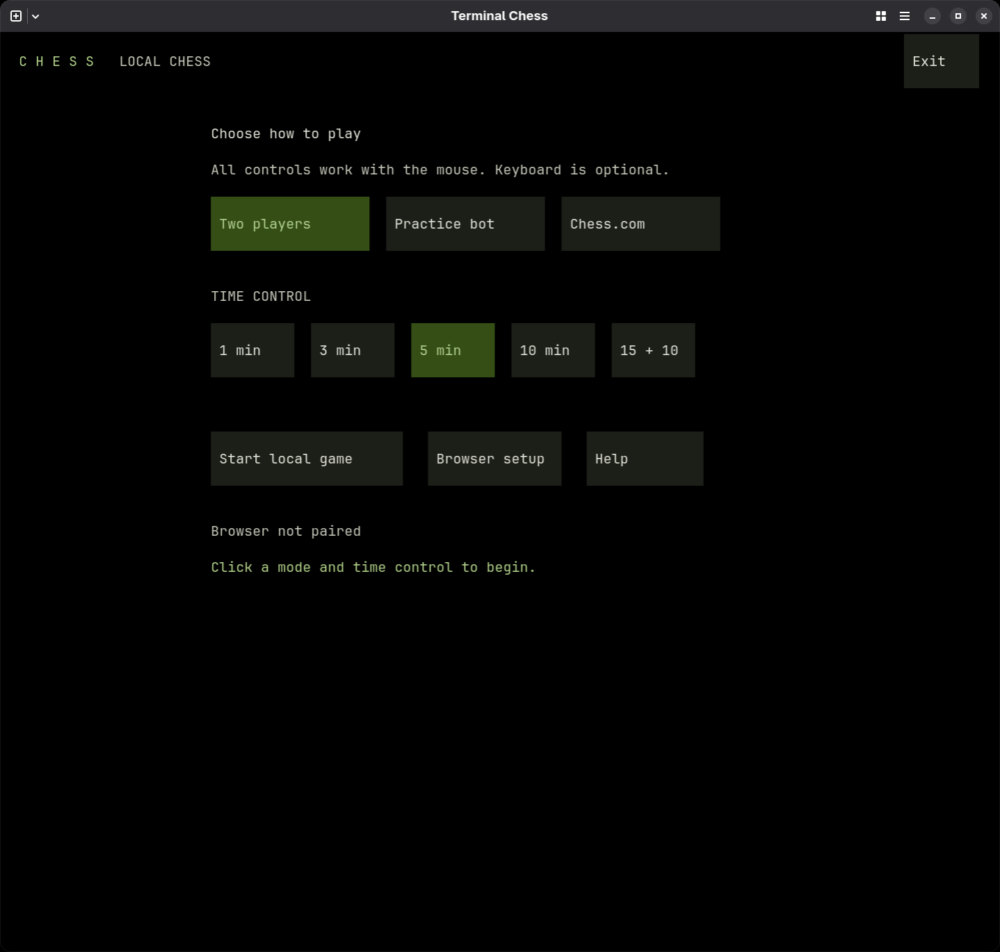

# Terminal Chess

A working mouse-driven chess TUI for Nathan, with read-only Noctalia colors, local two-player play, a weak offline practice bot, and an experimental Chess.com browser bridge. Private project.

## Launch

```sh
cd /home/nathanw/Projects/terminal-chess
npm ci
npm run install:local
chess
```

`chess` is already installed at `~/.local/bin/chess` on this machine. Normal launch opens a dedicated Ghostty session with `--mouse-reporting=true`; the global setting remains unchanged. Use `chess --here` only in a terminal that already permits mouse reporting. Node.js 22+ is required. Minimum size: 72 columns × 36 rows. Ghostty with truecolor is the tested target.

Click a mode, choose 1, 3, 5, 10, or 15+10, then start. Click a piece and destination. Right-drag draws arrows; right-click marks a square. Click **Mark** for left-drag/click annotation mode if the terminal captures right-click. Promotion choices, actions, help, menu, setup and exit all have mouse controls. Keyboard shortcuts are optional; move coordinates are never required.

## Actual runtime

These are screenshots of the running application in Ghostty, captured through the compositor. The selection/annotation state followed real application mouse events generated through a Wayland virtual pointer, not a human hardware test. They are not design mockups.




The pieces are original text silhouettes with uppercase/lowercase piece labels and high-contrast white/black cards. No bitmap rendering or graphics protocol is needed. ANSI truecolor plus Unicode line/dot symbols keep a TUI appearance. `CHESS_COLOR_MODE=256 chess` offers approximate color quantization for other terminals; that fallback has automated encoding checks but has not been visually verified on 256-color hardware.

## Chess.com setup and limits

The bridge is implemented and verified with a **real unpacked extension against controlled website fixtures**. Authenticated Chess.com game creation and live play are **not verified**. Website controls/API shapes may differ. The adapter deliberately stops on missing, ambiguous, stale or unknown controls instead of guessing.

1. Run `chess`, click **Browser setup → Open extension**.
2. In a Chromium browser, open its Extensions page, enable developer mode, and **Load unpacked** using this project's `extension/` folder. This is the original reviewed extension in this repository, not an installed upstream extension.
3. Open **Terminal Chess Bridge** extension options. Click **Copy token** in the TUI, paste into options, and click **Pair**.
4. Log in to Chess.com yourself and open `/play/online`. Click the extension toolbar icon on that tab to bind it.
5. In the TUI, choose **Chess.com**. An owned active game can be attached; otherwise choose a preset. The bridge opens the time-control menu to read Rated/Unrated before showing your confirmation. Creation requires an observed rated/unrated setting, verifies it again, selects the preset, then invokes Play once.

If the website uses unsupported selectors or does not expose a verifiable rated setting, terminal matchmaking stops before Play. Open the browser for setup/manual game creation, then attach from the TUI. No real games were started or player messages sent during verification. The public Chess.com data API is not treated as a live-play API.

No browser credentials leave the browser. Pairing is local, token-protected, and loopback-only. No engine advice is available in online mode. The practice bot is deliberately weak, local-only, and not Stockfish.

See [run guide and verification](docs/RUN.md), [security boundaries](docs/SECURITY.md), and [the illustrated design plan](PLAN.md).

## Development

```sh
npm ci
npx playwright install chromium  # only needed for browser fixture tests
npm test
npm run check
```

Tests cover legal special moves, clocks/results, mouse routing, annotations/promotion, contrast/schema validation, bridge authentication/ownership/staleness, browser control guards, and the full extension transport. Browser fixture tests never contact Chess.com; requests are intercepted locally. `CHESS_TEST_BROWSER` can override the browser executable for tests.

Reference: [a7mddra/chess-tui](https://github.com/a7mddra/chess-tui) informed the browser-board architecture. The tracked client and extension are original code; no upstream implementation was copied. Its MIT license was reviewed before development.
