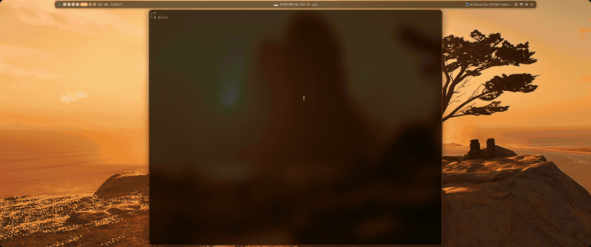

# Chess TUI

A mouse-driven graphical chess app that runs in your terminal, with local two-player play, an offline practice opponent, clocks, and annotations.

## Demo

[](https://github.com/natersalad/chess-tui/releases/download/offline-demo-v1/chess-tui-demo-v2.mp4)

[Watch or download the full-resolution video](https://github.com/natersalad/chess-tui/releases/download/offline-demo-v1/chess-tui-demo-v2.mp4), or view the [demo release](https://github.com/natersalad/chess-tui/releases/tag/offline-demo-v1). The demo shows offline gameplay.

## Features

- Original graphical pieces, physically square board geometry, and responsive sizing.
- Local two-player games and a simple offline practice opponent.
- 1, 3, 5, 10, and 15+10 time controls, with clocks and game results.
- Click-to-move or hold-and-drag input, legal move validation, castling, en passant, and promotion.
- Open-hand and closed-hand cursors, quick move animations, and right-click drag cancellation.
- Right-drag arrows, bent knight-move arrows, and right-click square marks. Left-click clears annotations.
- Distinct sounds for moves, captures, check, checkmate, draws, and invalid drops.
- Read-only Noctalia color integration with a fallback palette, plus terminal transparency.


**Chess.com live play is not available yet.** The access request is submitted and awaiting review. The public API cannot submit moves, and the required embedded browser is not implemented. Offline play works independently.

## Download and install

Requires Node.js 22+, npm, and a terminal that supports Kitty graphics, truecolor, and mouse reporting. Ghostty is the tested terminal. Minimum terminal size: 72 columns × 36 rows. `paplay` from `libpulse` is optional for sounds; `xdg-open` from `xdg-utils` is optional for opening setup/help links.

```sh
git clone https://github.com/natersalad/chess-tui.git
cd chess-tui
npm ci
npm run install:local
```

The installer creates a `chess` launcher in `~/.local/bin`; include that directory in your `PATH`. It refuses to overwrite an unrelated existing launcher and does not change desktop or terminal configuration.

An Arch Linux package build is available in [packaging/aur](packaging/aur/README.md). It is not published in AUR yet.

### Homebrew (initial test candidate)

With Homebrew already installed:

```sh
brew tap --custom-remote natersalad/chess-tui https://github.com/natersalad/chess-tui.git
brew install --build-from-source natersalad/chess-tui/chess-tui
chess-tui
```

Use Ghostty in the current terminal. The formula installs `chess-tui` without replacing `chess`. Linux staged-runtime checks passed; Homebrew installation and macOS gameplay still need testing. On macOS, sounds are not implemented and `--window` is unsupported. See the [Mac smoke-test and troubleshooting instructions](packaging/homebrew/README.md).

## Launch and play

```sh
chess
```

Choose a mode and time control with the mouse, then start. Click a piece and destination, or hold the left mouse button to drag and release on a legal square. Invalid drops return the piece and play an error sound. Right-click while holding a piece cancels the drag. Promotion waits for your choice.

Normal launch uses the current terminal and returns to the shell when you exit. Enable mouse reporting in your terminal settings if mouse input is disabled. The board preserves your terminal dimensions and supports manual resizing.

- `chess --window`: open a separate Ghostty window with mouse reporting enabled for that session.
- `chess --text`: use the basic text renderer explicitly.
- `chess --doctor`: report local capabilities and connection status.
- `chess --setup`: print the supported Chess.com access-request guidance.
- `chess --help`: list launch options.

## License

Code and original artwork are licensed under [MIT](LICENSE). Bundled wooden recordings retain their CC0 terms and [attribution](assets/ATTRIBUTION.md); dependencies retain their respective licenses. Locally downloaded Chess.com sounds are not distributed.
