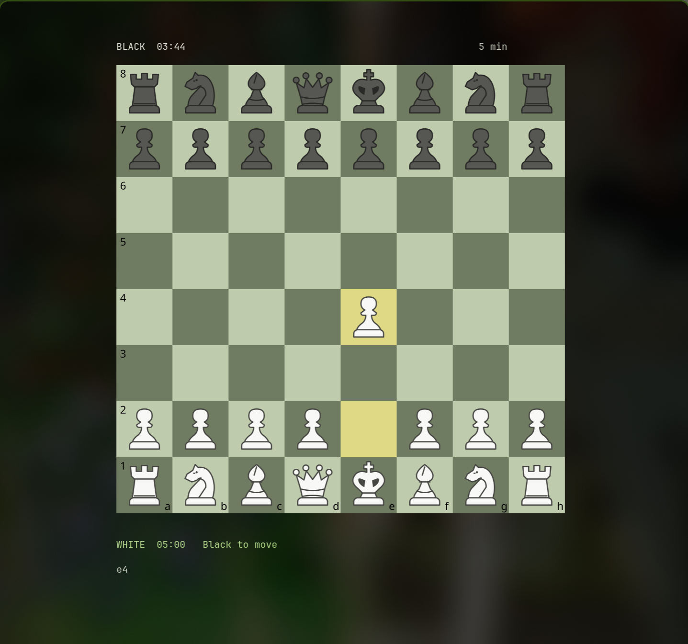
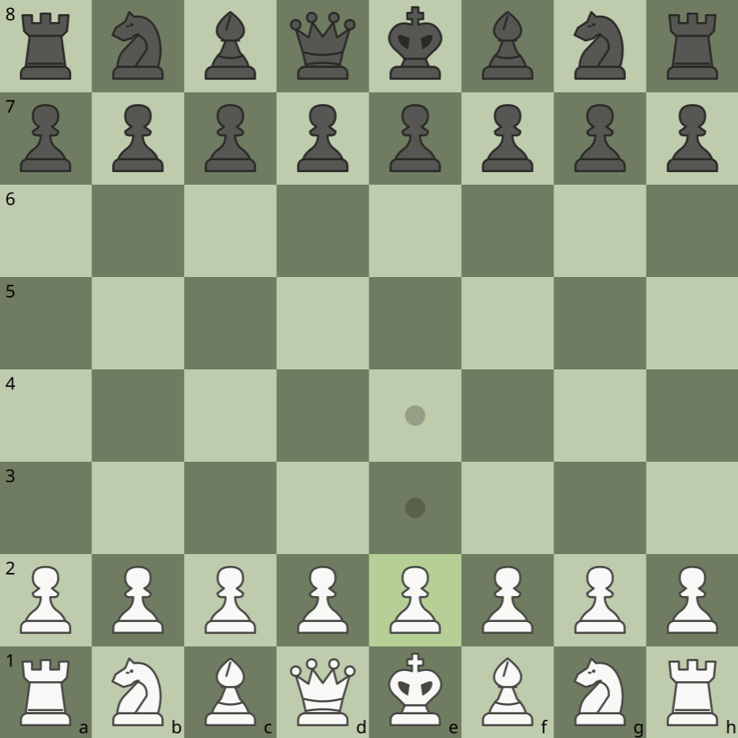
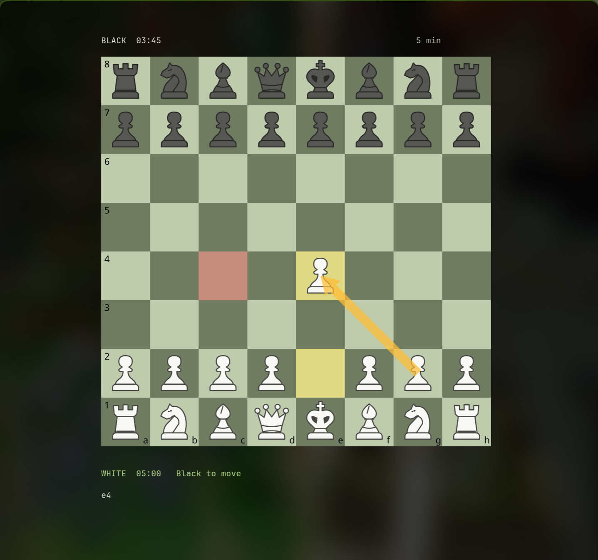

# Run guide — graphical board and scoped cleanup

Run **`chess`** in your current terminal. It uses that terminal and returns to your shell on exit; no extra window opens. `chess --window` explicitly requests the separate mouse-enabled Ghostty window. Mouse input requires the existing terminal to allow mouse reporting; this machine’s Ghostty setting now enables it, with Nathan’s approval. Choose a mode and time control in the mouse-controlled launch menu, then start. The in-game view contains only the graphical board, opponent clock above, user's clock below, and restrained turn/status text. No Mark/Flip/Clear/Help/Menu toolbar, verification heading, or move-instruction text is shown during play.

- Left-click a piece and then its destination. Every normal left-click on the board clears **all user arrows and red square marks**, including clicks on empty squares.
- Hold the right mouse button, drag, and release over a different square to draw a broad translucent gold arrow. Nothing is previewed while holding/moving.
- Right-click and release on the same square to toggle a translucent red square fill. Red derives from Noctalia's semantic error color, with a readable red fallback. There are no annotation circles; legal-move dots/capture hints remain separate.
- Promotion choices remain clickable. Ctrl+C exits and restores terminal modes; the compositor can also close the window. Optional shortcuts remain, without a visible in-game toolbar.

The primary board is an original SVG/vector composition rasterized to PNG and displayed **inside Ghostty using Kitty graphics**, not ASCII, Unicode chess glyphs, or letter labels. Smooth centered white/dark pieces, inset edge coordinates, square geometry, highlights and large arrows follow Nathan's supplied reference while retaining Noctalia colors. `chess --text` is an explicit basic fallback; it is never silently substituted for the primary graphical board.

Ghostty 1.3.1 returned `i=991;OK` to the live graphics probe and `6;26;12t` for 12×26-pixel cells. The app calculates physical square geometry and terminal mouse hitboxes from those cells. Missing image support is reported explicitly. Native titlebar/decorations and tab chrome are disabled **only when using the optional dedicated `--window` app process** with Ghostty command-line options. The Niri compositor's thin focus border remains; no global terminal or desktop settings were changed.

Surrounding cells use the terminal's default background rather than an opaque RGB fill. Existing Ghostty opacity and blur are preserved. The board image itself remains opaque and readable. The app reads Noctalia's generated palette and refreshes validated color changes; dark-square derivation protects piece-outline contrast. No Noctalia configuration or palette template is written.

## Rendering stability and verification

Text rendering now diffs individual cells; unchanged frames emit nothing, and clock changes touch only changed text. Arrow hold/motion does not redraw or rasterize. Board updates upload a complete PNG into the inactive Kitty image buffer, then place it and remove the prior image in a synchronized update. The visible board is not deleted while its replacement is being uploaded. Ratatui was considered; this scoped rendering fix did not require a framework/language rewrite.

Actual Ghostty verification used Wayland virtual-pointer events and compositor captures, not a human hardware test. Samples measured unchanged board pixels while the right button was held, no blank board frames after release, and clearing on left-click. This is sampled live-runtime evidence, not a guarantee about every GPU refresh. Exact measurements are in `runtime/stability.json`.

32 tests pass, including clear on empty/occupied-square clicks, mark release semantics, red derivation/fallback, no preview/transmission while dragging, buffer ordering, sparse text updates, legal moves/promotion, clocks, and the unchanged browser bridge boundaries. Syntax and asset checks pass.

Authenticated Chess.com play remains unverified. Existing extension setup is described in README; no real rated games or player messages were used to test this cleanup. This update adds no account setup or unrelated features.

## Actual screenshots

The screenshots are actual running-app captures. The earlier ASCII board is retained as `runtime/before-ascii.png` for comparison only.

Knight-move annotations use a right-angle bend: the two-square leg first, then the one-square leg, in either board orientation. Other arrows remain straight.

Hold the left mouse button on your piece and drag it across the board. Release to make a legal move. An invalid or off-board drop returns the piece to its original square and plays a short local error tone through `paplay`. Click-then-click movement still works. Promotion waits for your choice. Restart chess to load updates.

The pointer becomes an open hand over a movable piece and a closed hand while the left button holds it. Ghostty cursor shapes use [OSC 22](https://ghostty.org/docs/vt/osc/22); the app restores the terminal cursor on exit. Hovering alone never moves a piece.

Smooth dragging: the board stays cached during motion, and the held piece is uploaded once as a transparent sprite. Subsequent motion sends only a small placement update, using sub-cell pixel offsets. Pixel mouse reporting is enabled only after a supported-mode reply; other terminals keep the cell-coordinate fallback. This uses the [Kitty graphics placement protocol](https://sw.kovidgoyal.net/kitty/graphics-protocol/). No animation or interpolation is added. Automated checks verify 60 consecutive movements without re-uploading the board or sprite; perceived smoothness on Nathan’s desktop still needs a live check.

Right-click while holding a piece cancels the drag and restores its original square, without creating an annotation or making a move. Successful placements play a short local piece sound; invalid drops retain their separate error tone. Online placement sound waits for a confirmed board change rather than a submitted request.

Cancellation cleanup fully deletes the held sprite image and invalidates its upload cache before restoring the board. In a scripted live Ghostty check, the post-cancel screenshot matched the pre-drag screenshot pixel for pixel. Nathan’s mouse trace showed the first right-button press already cleared the held state; this check verifies rendering restoration, not a repeat physical mouse test.

Ghostty drag fallback: a Linux mouse-button reader handles missing right-button presses and left-button releases during a held gesture. It reads only left/right button transitions from mouse-capable devices while chess runs, does not grab devices or store input, and closes on exit. Normal terminal release events take priority. If device access is unavailable, terminal reporting remains the fallback. A live virtual-pointer test reproduced Ghostty withholding chord/release events; the direct physical mouse fallback still needs Nathan’s confirmation.

Successful graphical moves use a quick 110 ms eased glide into the destination square, including click-to-move, drag placement and practice-bot moves. The held sprite stays cached during the glide; invalid drops and right-click cancellation remain immediate.
